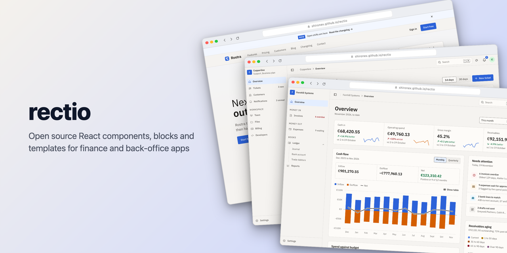
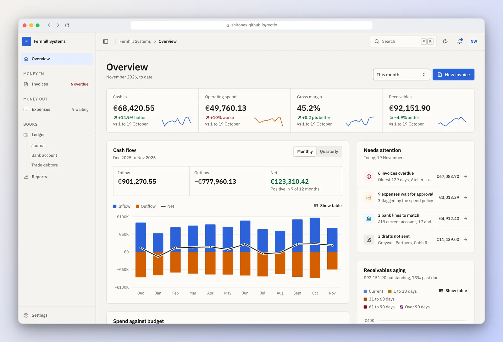
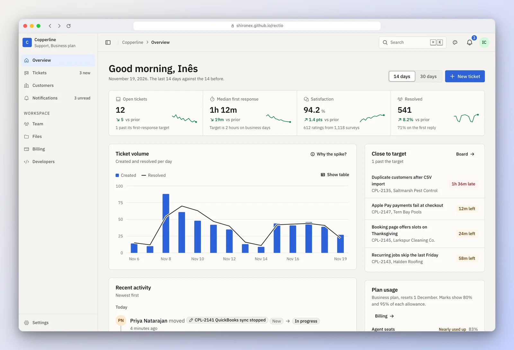
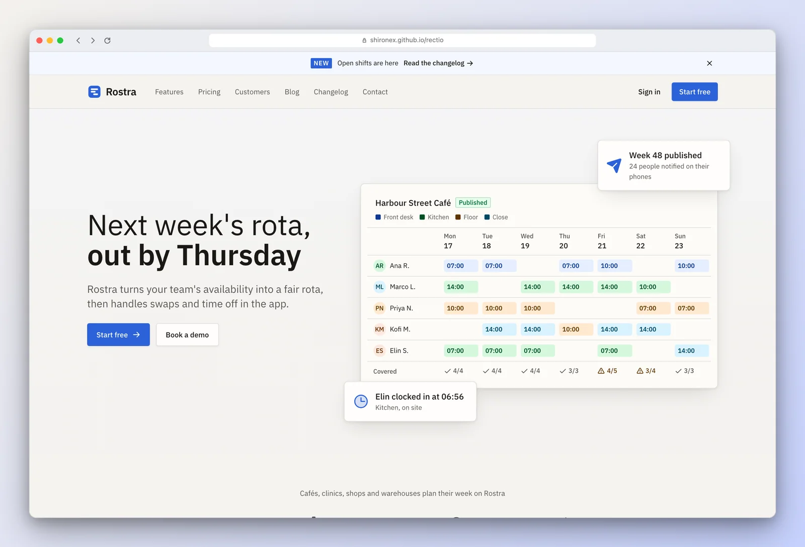
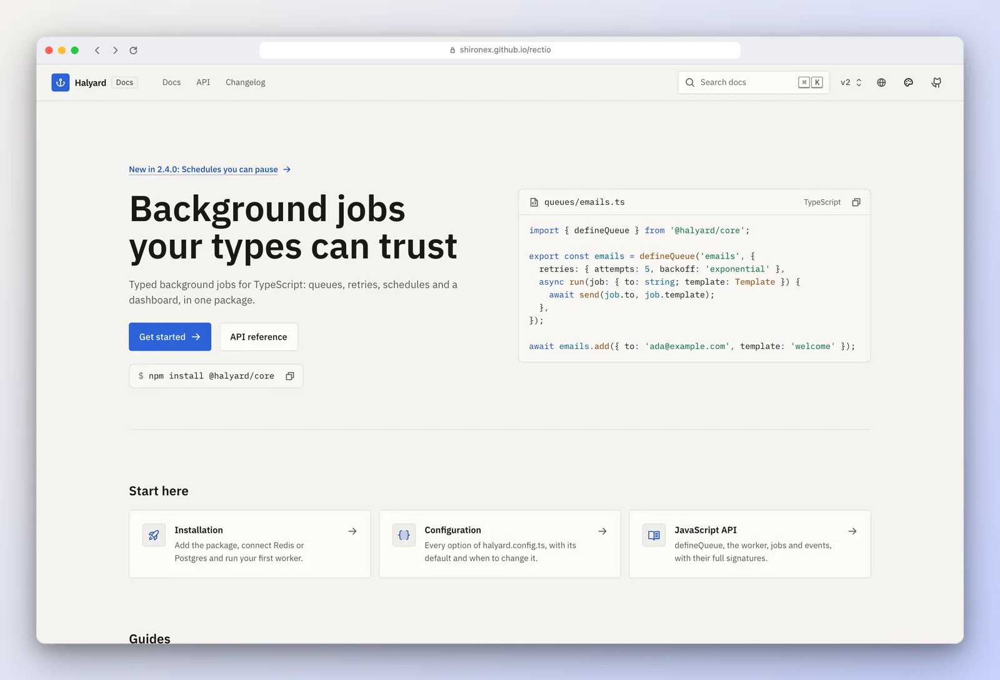
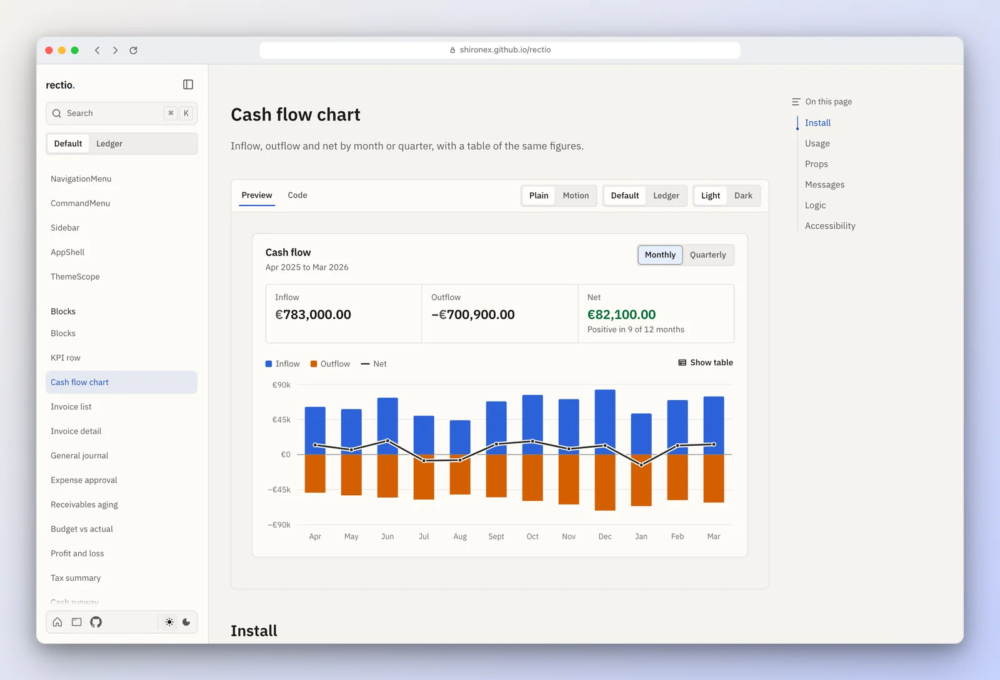
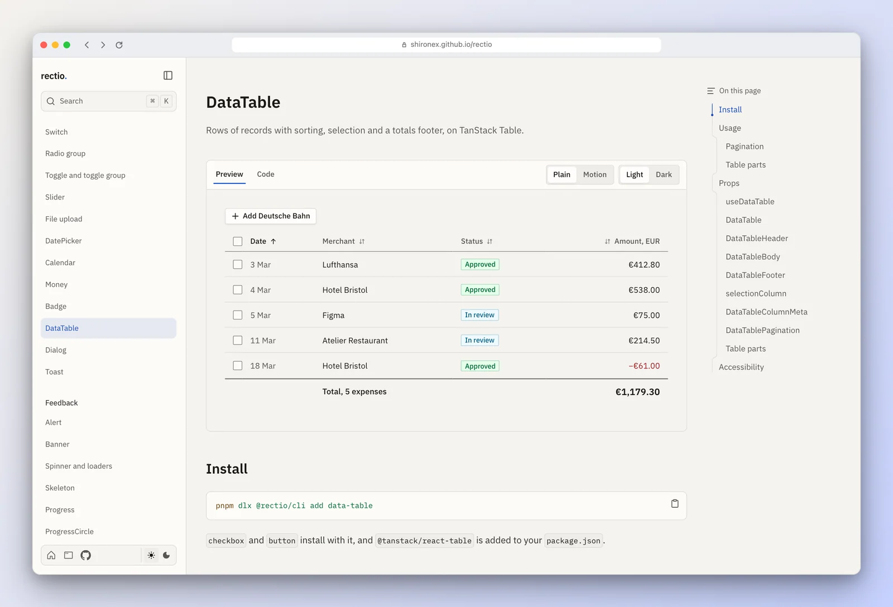

<div align="center">
  <picture>
    <source media="(prefers-color-scheme: dark)" srcset="assets/showcase/hero-dark.png">
    <source media="(prefers-color-scheme: light)" srcset="assets/showcase/hero-light.png">
    
  </picture>

  <h1>rectio</h1>

  <p><strong>Open source React components, blocks and whole-app templates for finance and back-office software.</strong></p>

  <p>
    <a href="https://github.com/Shironex/rectio/actions/workflows/ci.yml"></a>
    <a href="https://github.com/Shironex/rectio/actions/workflows/pages.yml"></a>
    <a href="LICENSE"></a>
  </p>

  <p>
    <a href="https://shironex.github.io/rectio/docs"><strong>Docs</strong></a>
    &nbsp;·&nbsp;
    <a href="https://shironex.github.io/rectio/templates"><strong>Templates</strong></a>
    &nbsp;·&nbsp;
    <a href="https://shironex.github.io/rectio/preview/finance-app/"><strong>Live preview</strong></a>
    &nbsp;·&nbsp;
    <a href="CONTRIBUTING.md"><strong>Contributing</strong></a>
  </p>
</div>

---

## What is rectio?

A React UI kit for the screens where a wrong sign costs money: invoices, ledgers, approvals,
payouts, and the SaaS, marketing and docs pages around them. It is built on
[Base UI](https://base-ui.com) primitives and Tailwind CSS v4, and every component is styled only
through design tokens, so a theme restyles all of it without a fork.

It ships as source. A CLI copies what you pick into your project, rewritten to your import aliases,
and from then on the code is yours. Everything is free and MIT licensed.

## Screenshots

<table>
  <tr>
    <td width="50%">
      <picture>
        <source media="(prefers-color-scheme: dark)" srcset="assets/showcase/dark/finance-app.webp">
        
      </picture>
    </td>
    <td width="50%">
      <picture>
        <source media="(prefers-color-scheme: dark)" srcset="assets/showcase/dark/saas-admin.webp">
        
      </picture>
    </td>
  </tr>
  <tr>
    <td align="center"><sub>Finance app template</sub></td>
    <td align="center"><sub>SaaS admin template</sub></td>
  </tr>
  <tr>
    <td width="50%">
      <picture>
        <source media="(prefers-color-scheme: dark)" srcset="assets/showcase/dark/saas-landing.webp">
        
      </picture>
    </td>
    <td width="50%">
      <picture>
        <source media="(prefers-color-scheme: dark)" srcset="assets/showcase/dark/docs-template.webp">
        
      </picture>
    </td>
  </tr>
  <tr>
    <td align="center"><sub>SaaS landing template</sub></td>
    <td align="center"><sub>Docs template</sub></td>
  </tr>
  <tr>
    <td width="50%">
      <picture>
        <source media="(prefers-color-scheme: dark)" srcset="assets/showcase/dark/cash-flow.webp">
        
      </picture>
    </td>
    <td width="50%">
      <picture>
        <source media="(prefers-color-scheme: dark)" srcset="assets/showcase/dark/data-table.webp">
        
      </picture>
    </td>
  </tr>
  <tr>
    <td align="center"><sub>Cash flow block</sub></td>
    <td align="center"><sub>DataTable component</sub></td>
  </tr>
</table>

Every template runs live on the docs site, page by page, at desktop, tablet and phone width, in both
themes: [open the templates gallery](https://shironex.github.io/rectio/templates).

## What is in it

|                   |                                                                                                                                                       |
| ----------------- | ----------------------------------------------------------------------------------------------------------------------------------------------------- |
| **59 components** | Forms, overlays, navigation, data display and finance primitives: Field, Select, DataTable, DatePicker, Money, Dialog, Sidebar, Command menu and more |
| **61 blocks**     | 14 finance, 18 SaaS and app, 16 marketing and 13 docs blocks: data agnostic, typed props in and callbacks out                                         |
| **5 templates**   | Whole Next.js apps: a finance back office, a help desk admin, a SaaS marketing site, a product launch page and a docs site                            |
| **Motion add-on** | 73 motion twins (24 components, 49 blocks) with the same names and props as the plain ones, about 13 kB gzip, plain under reduced motion              |
| **2 themes**      | `default` and `ledger`, each in light and dark, with a compact density; 208 tokens per theme and mode                                                 |
| **CLI**           | `rectio init`, `add`, `diff`, `list`, `search` and `update`, with integrity checks and a lockfile that respects your edits                            |
| **MCP server**    | `rectio mcp`: seven read-only tools, so a coding agent can look up items, tokens, docs and source instead of guessing                                 |

Accessibility is part of every item: correct roles and labels, a complete keyboard path, visible
focus, 44px targets on touch screens, and meaning never carried by colour alone. Figures are tabular
and lining, and money uses the true minus sign.

## Quick start

rectio needs React 19 and Tailwind CSS v4, in a Vite, Next.js or TanStack Start project.

```sh
pnpm dlx @rectio/cli init                                # tokens, a theme and the cn helper
pnpm dlx @rectio/cli add button dialog data-table        # components, with what they depend on
pnpm dlx @rectio/cli add invoice-list motion-kpi-row     # blocks, plain or with motion
pnpm dlx @rectio/cli init --template finance-app my-app  # a whole app in a new folder
```

The CLI is published on npm as [`@rectio/cli`](https://www.npmjs.com/package/@rectio/cli).
`npx @rectio/cli` works as well, and `pnpm add -g @rectio/cli` gives you a plain `rectio` command.
It reads the registry published with the docs at `https://shironex.github.io/rectio/r`.

The [installation guide](https://shironex.github.io/rectio/docs/installation) covers the flags, the
lockfile and the CSS entry the CLI manages.

## Theming

Components never hardcode a colour, radius, font, shadow, duration or easing: all of it comes from
CSS variables generated from DTCG token files. A theme is one set of those values, applied with
attributes:

```html
<html data-theme="ledger" data-mode="dark" data-density="compact"></html>
```

`default` is warm stone neutrals with a cobalt accent and IBM Plex; `ledger` is green-black ink with
a citron accent, serif headings, sharper corners and slower motion. A new theme is one more set of
token files; [theming](https://shironex.github.io/rectio/docs/theming) shows how.

## For coding agents

`rectio mcp` runs a read-only MCP server over stdio for Claude Code, Cursor or VS Code. It lists and
searches items, returns source with your aliases, gives token values per theme and mode, and prints
the exact `rectio add` command. It never writes files. The editor starts it as `rectio mcp`, so
install the CLI globally first.

```sh
pnpm add -g @rectio/cli
claude mcp add rectio --scope project -- rectio mcp
```

Setup for the other editors is on the [MCP page](https://shironex.github.io/rectio/docs/mcp).

## Repository

| Path                | What it is                                                              |
| ------------------- | ----------------------------------------------------------------------- |
| `packages/tokens`   | Token sources and the build into CSS variables and a Tailwind v4 theme  |
| `packages/ui`       | The components                                                          |
| `packages/motion`   | The motion add-on                                                       |
| `packages/blocks`   | The blocks: finance, SaaS, marketing and docs                           |
| `packages/registry` | The item schema and the build that writes the static registry           |
| `packages/cli`      | The `rectio` CLI and its MCP server                                     |
| `templates/*`       | The templates, each a standalone Next.js app                            |
| `apps/site`         | The docs site, the landing page and the live template previews          |
| `apps/playground`   | A Vite gallery of every component and block, and the screenshot scripts |

```sh
pnpm install
pnpm dev     # the playground
pnpm gate    # format, lint, typecheck, test, build and the repo rules
```

[docs/ARCHITECTURE.md](docs/ARCHITECTURE.md) explains how the registry, the CLI and the previews
work. The images in this README come from `pnpm --filter @rectio/site showcase`, run after a site
build.

## Contributing

I build rectio on my own, and contributions are very welcome: bug reports, requests for components,
blocks and templates, and pull requests for new components. Start with
[CONTRIBUTING.md](CONTRIBUTING.md) for the setup, the rules and the design bar every item goes
through. Everyone taking part follows the [Code of Conduct](CODE_OF_CONDUCT.md); report a
vulnerability privately as [SECURITY.md](SECURITY.md) describes.

## License

[MIT](LICENSE). Made by noctcore.
